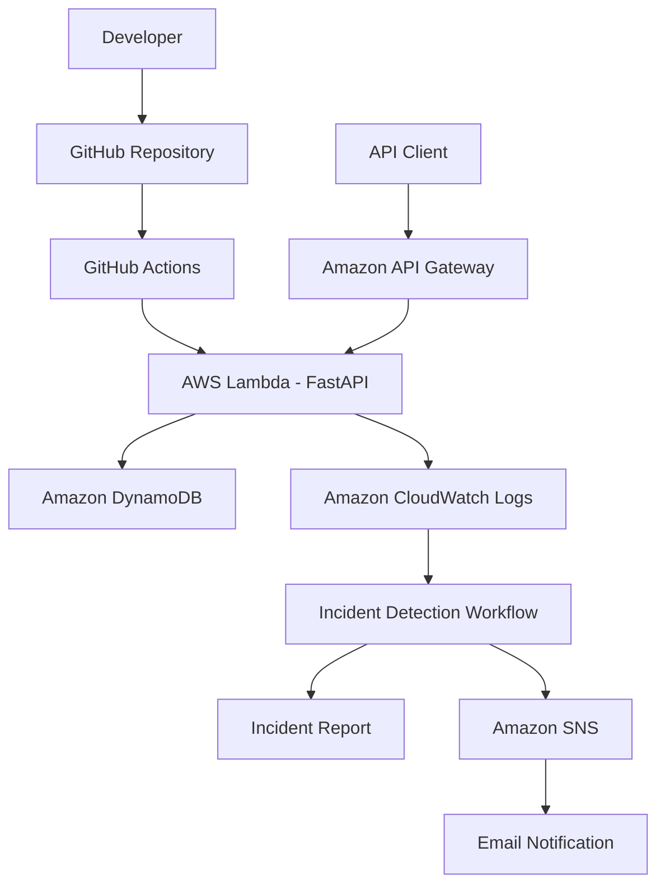
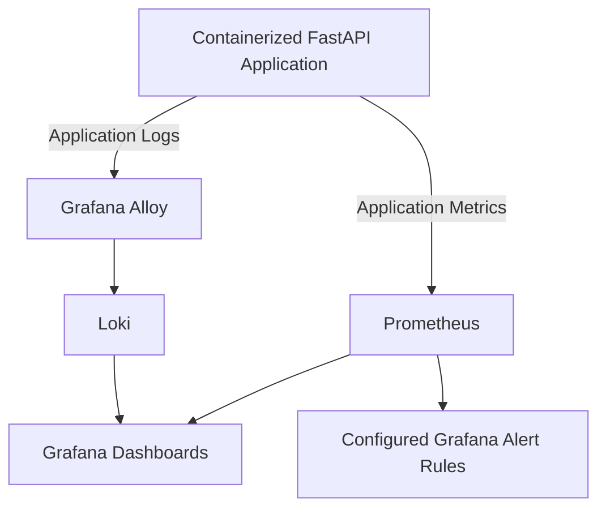
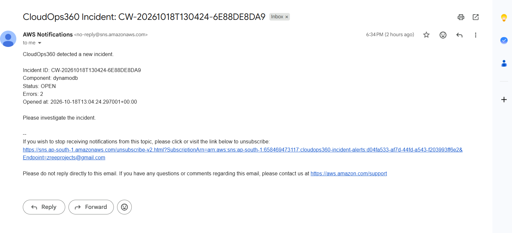
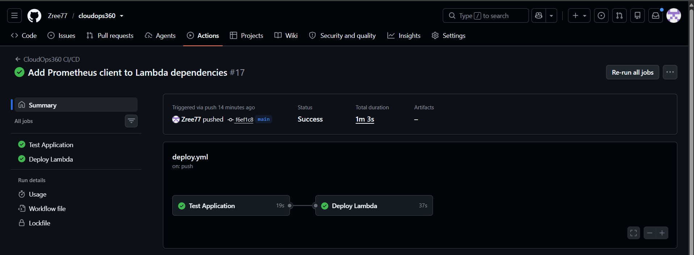
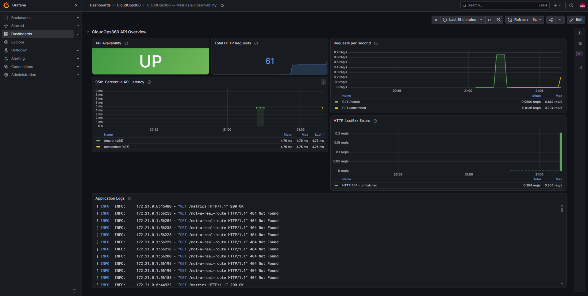
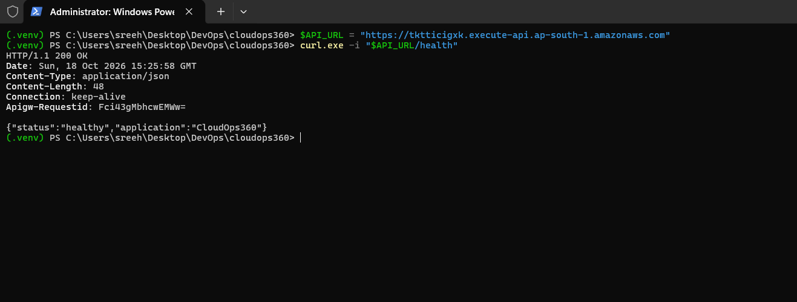

# CloudOps360 — Cloud Incident Detection and Monitoring

CloudOps360 is a cloud operations and incident monitoring project that combines a serverless REST API, AWS CloudWatch log analysis, automated incident detection, recovery verification, and Amazon SNS email notifications.

The project also includes a containerized observability stack using Prometheus, Grafana Alloy, Loki, and Grafana to monitor application metrics and logs.

The goal is to demonstrate practical DevOps and cloud engineering workflows, including CI/CD automation, automated testing, cloud monitoring, incident reporting, and notification delivery.

---

## Table of Contents

- [Project Overview](#project-overview)
- [Features](#features)
- [Architecture](#architecture)
- [Technology Stack](#technology-stack)
- [Project Structure](#project-structure)
- [AWS Deployment](#aws-deployment)
- [API Endpoints](#api-endpoints)
- [Incident Detection and Recovery](#incident-detection-and-recovery)
- [Amazon SNS Notifications](#amazon-sns-notifications)
- [CI/CD Pipeline](#cicd-pipeline)
- [Local Observability Stack](#local-observability-stack)
- [Testing](#testing)
- [Screenshots](#screenshots)
- [Security Considerations](#security-considerations)
- [Current Project Status](#current-project-status)
- [Future Enhancements](#future-enhancements)
- [Author](#author)

---

## Project Overview

CloudOps360 brings together cloud application deployment, monitoring, and incident response workflows.

The project has two main parts:

1. **AWS serverless application:** A FastAPI application deployed to AWS Lambda and exposed through Amazon API Gateway. AWS services support application data storage, log collection, incident detection, and notifications.
2. **Local observability environment:** A Docker Compose stack that collects application metrics and logs and makes them available through Prometheus and Grafana.

When the incident detection workflow identifies a qualifying issue in CloudWatch logs, it generates an incident record and can publish an email notification through Amazon SNS.

The project also includes automated tests and a GitHub Actions workflow for testing and deployment.

## Features

### 1. Serverless REST API

- FastAPI application deployed on AWS Lambda.
- Amazon API Gateway integration.
- Health check and application information endpoints.
- Task-related API endpoints.
- Mangum integration for running FastAPI through AWS Lambda.

### 2. Cloud Incident Detection

- Retrieves application logs from Amazon CloudWatch Logs.
- Analyzes logs for potential errors and incidents.
- Generates incident reports with identifiers, affected components, status, and error counts.
- Supports incident notification through Amazon SNS.

### 3. Recovery Verification

- Includes recovery verification logic.
- Tests incident and recovery-related behavior.
- Helps validate whether an incident's recovery conditions have been satisfied.

### 4. Email Notifications

- Integrates Amazon SNS with the incident detection workflow.
- Publishes incident notifications containing relevant incident details.
- Email delivery has been verified using a received SNS notification.

### 5. Application Observability

- Prometheus collects application metrics.
- Grafana Alloy collects and forwards application logs.
- Loki stores and serves logs.
- Grafana provides dashboards for application metrics and logs.
- Includes configured alert rules for API availability and high server-error rates.

### 6. Automated Testing

- Pytest-based test suite.
- Tests API behavior and incident-related functionality.
- Includes notification deduplication tests.

### 7. CI/CD Automation

- GitHub Actions workflow.
- Automated test execution.
- Lambda deployment packaging.
- AWS authentication using OpenID Connect (OIDC).
- Automated deployment to AWS Lambda.
- Post-deployment API health check.

---

## Architecture

CloudOps360 separates its AWS deployment from its local observability environment.

### AWS Application and Incident Detection



### Local Observability Environment



**Architecture note:** The local Prometheus and Grafana stack monitors the containerized application. It is separate from the deployed AWS Lambda application and does not automatically monitor Lambda unless an additional integration is configured.

---

## Technology Stack

| Category | Technologies |
|---|---|
| Programming Language | Python |
| API Framework | FastAPI |
| Serverless Compute | AWS Lambda |
| API Management | Amazon API Gateway |
| Database | Amazon DynamoDB |
| Cloud Logging | Amazon CloudWatch Logs |
| Notifications | Amazon SNS |
| AWS SDK | Boto3 |
| Lambda Adapter | Mangum |
| Metrics Collection | Prometheus |
| Log Collection | Grafana Alloy |
| Log Storage | Loki |
| Dashboards and Alert Rules | Grafana |
| Containerization | Docker |
| Container Orchestration | Docker Compose |
| CI/CD | GitHub Actions |
| Authentication for Deployment | AWS IAM and GitHub Actions OIDC |
| Testing | Pytest |
| Version Control | Git and GitHub |

---

## Project Structure

The following represents the main project organization. Adjust filenames if your local repository differs.

```text
cloudops360/
├── .github/
│   └── workflows/
│       └── deploy.yml
│
├── app/
│   └── main.py
│
├── scripts/
│   ├── fetch_cloudwatch_logs.py
│   ├── analyze_cloudwatch_logs.py
│   ├── detect_cloudwatch_incidents.py
│   └── generate_incident_report.py
│
├── tests/
│   └── ...
│
├── observability/
│   ├── prometheus/
│   │   └── prometheus.yml
│   └── grafana/
│       └── provisioning/
│           └── alerting/
│               └── alert_rules.yaml
│
├── docs/
│   └── images/
│       ├── github-actions-deployment.png
│       ├── api-health-check.png
│       ├── grafana-observability-dashboard.png
│       ├── incident-detection-report.png
│       └── sns-incident-notification.png
│
├── logs/
├── requirements.txt
├── lambda_requirements.txt
├── compose.yml
├── Dockerfile
├── pytest.ini
└── README.md
```

**Important:** Keep only files and directories that actually exist in your repository. The `tests/` directory may contain multiple test modules.

---

## AWS Deployment

### Deployed Resources

The AWS deployment uses the following components:

- **AWS Lambda:** Runs the FastAPI application.
- **Amazon API Gateway:** Exposes the application through an HTTP API endpoint.
- **Amazon DynamoDB:** Provides application data storage.
- **Amazon CloudWatch Logs:** Collects application logs.
- **Amazon SNS:** Publishes incident notifications.
- **GitHub Actions:** Automates testing and Lambda deployment.

### Deployed API

**API Base URL:**

https://tktticigxk.execute-api.ap-south-1.amazonaws.com

**Health Check:**

https://tktticigxk.execute-api.ap-south-1.amazonaws.com/health

**Application Root:**

https://tktticigxk.execute-api.ap-south-1.amazonaws.com/

**API Documentation:**

https://tktticigxk.execute-api.ap-south-1.amazonaws.com/docs

The root and health endpoints have been tested successfully and returned HTTP 200 responses.

### Health Check Response

Example:

```json
{
  "status": "healthy",
  "application": "CloudOps360"
}
```

### Application Root Response

Example:

```json
{
  "application": "CloudOps360",
  "message": "Welcome to CloudOps360 API",
  "docs": "/docs"
}
```

---

## API Endpoints

The following endpoints are documented for the application.

| Method | Endpoint | Purpose |
|---|---|---|
| GET | `/` | Returns application information |
| GET | `/health` | Checks application health |
| GET | `/ready` | Checks application readiness |
| GET | `/docs` | Opens the FastAPI Swagger documentation |
| GET | `/tasks` | Lists tasks |
| POST | `/tasks` | Creates a task |
| GET | `/tasks/{task_id}` | Retrieves a task |
| PUT | `/tasks/{task_id}` | Updates a task |
| DELETE | `/tasks/{task_id}` | Deletes a task |

The exact task operations depend on the routes implemented in the current application version.

---

## Incident Detection and Recovery

CloudOps360 includes scripts for retrieving CloudWatch logs, analyzing errors, detecting incidents, and generating incident reports.

### Workflow

1. Retrieve relevant logs from Amazon CloudWatch Logs.
2. Analyze the collected log entries.
3. Identify potential incidents based on the implemented detection logic.
4. Generate incident information, including the incident identifier, affected component, status, and error count.
5. Publish an SNS notification when the notification workflow is triggered.
6. Validate incident and recovery behavior through automated tests.

### Relevant Scripts

| Script | Purpose |
|---|---|
| `scripts/fetch_cloudwatch_logs.py` | Retrieves CloudWatch log data |
| `scripts/analyze_cloudwatch_logs.py` | Analyzes collected logs |
| `scripts/detect_cloudwatch_incidents.py` | Detects incidents and triggers the notification workflow |
| `scripts/generate_incident_report.py` | Generates an incident report |

Run scripts from the project root using the Python environment configured for your project.

For example:

```powershell
python scripts/fetch_cloudwatch_logs.py
```

```powershell
python scripts/analyze_cloudwatch_logs.py
```

```powershell
python scripts/detect_cloudwatch_incidents.py
```

```powershell
python scripts/generate_incident_report.py
```

The scripts may require AWS credentials, suitable IAM permissions, and the expected CloudWatch configuration.

Review the configuration and script arguments before running them. Do not commit AWS credentials or other secrets to the repository.

---

## Amazon SNS Notifications

CloudOps360 integrates Amazon Simple Notification Service (SNS) into its incident detection workflow.

When a qualifying incident is detected, the workflow can publish an email notification through the configured SNS topic.

The notification contains details such as:

- Incident ID
- Affected component
- Incident status
- Error count
- Incident opening timestamp

### Example Incident

```text
Application: CloudOps360
Incident ID: CW-20261018T130424-6E88DE8DA9
Component: dynamodb
Status: OPEN
Errors: 2
```

The incident notification was received by email from AWS Notifications, confirming successful email delivery for the tested incident.

### Incident Email Screenshot



---

## CI/CD Pipeline

CloudOps360 uses GitHub Actions to automate testing and deployment.

### Pipeline Workflow

1. A change is pushed to the GitHub repository.
2. GitHub Actions runs the configured workflow.
3. Python dependencies required for testing are installed.
4. Automated tests are executed.
5. Lambda deployment dependencies are installed from `lambda_requirements.txt`.
6. The application and its dependencies are packaged for Lambda.
7. GitHub Actions authenticates with AWS using the configured OIDC role.
8. The deployment job updates the AWS Lambda function.
9. The workflow checks the deployed API health endpoint.

The workflow separates test dependencies from the dependencies packaged for Lambda.

### Deployment Configuration

The workflow is located at:

```text
.github/workflows/deploy.yml
```

The deployed Lambda function is:

```text
cloudops360-dev-api
```

The AWS region is:

```text
ap-south-1
```

### CI/CD Screenshot



---

## Local Observability Stack

CloudOps360 includes a Docker Compose-based observability environment.

The stack contains:

| Component | Responsibility |
|---|---|
| FastAPI application | Exposes the application and metrics endpoint |
| Prometheus | Collects and queries application metrics |
| Grafana Alloy | Collects and forwards application logs |
| Loki | Stores and queries application logs |
| Grafana | Displays dashboards and configured alert rules |

### Start the Stack

Ensure Docker Desktop is running, then execute these commands from the project root:

```powershell
docker compose up -d --build
```

Check the running containers:

```powershell
docker compose ps
```

View container logs:

```powershell
docker compose logs -f
```

Stop the stack:

```powershell
docker compose down
```

To stop the stack and remove its named volumes, use:

```powershell
docker compose down -v
```

**Warning:** Removing volumes deletes the data stored in those volumes. Do not use `-v` if you need to retain the monitoring data.

### Local Service URLs

| Service | URL |
|---|---|
| Application | http://localhost:8000 |
| Application Metrics | http://localhost:8000/metrics |
| Prometheus | http://localhost:9090 |
| Grafana | http://localhost:3000 |
| Loki | http://localhost:3100 |
| Grafana Alloy | http://localhost:12345 |

The exact available endpoints and port mappings depend on the current `compose.yml` configuration.

### Prometheus Metrics

The application exposes metrics that Prometheus can scrape.

Examples include:

```text
cloudops360_http_requests_total
```

This counter tracks HTTP requests by method, endpoint, and status code.

```text
cloudops360_http_request_duration_seconds
```

This histogram records HTTP request durations.

Example PromQL queries:

**Total HTTP requests**

```promql
sum(cloudops360_http_requests_total)
```

**HTTP 5xx errors**

```promql
sum(cloudops360_http_requests_total{status_code=~"5.."})
```

**Requests per second**

```promql
sum(rate(cloudops360_http_requests_total[5m]))
```

**95th percentile request latency**

```promql
histogram_quantile(
  0.95,
  sum by (le) (
    rate(cloudops360_http_request_duration_seconds_bucket[5m])
  )
)
```

These queries depend on the corresponding metrics being exposed and scraped successfully.

### Grafana Dashboard

The dashboard includes panels for:

- API availability
- Total HTTP requests
- Request rate
- 95th percentile request latency
- HTTP 4xx and 5xx errors
- Application logs



### Grafana Alert Rules

The project includes configured alert rules for:

- API unavailability
- High HTTP 5xx server-error rates

The rules are configured in:

```text
observability/grafana/provisioning/alerting/alert_rules.yaml
```

The presence of configured rules does not, by itself, confirm that notifications are being delivered. End-to-end Grafana alert notification delivery remains to be verified.

---

## Testing

CloudOps360 uses Pytest to validate application behavior and incident-related functionality.

### Run the Tests

Create and activate a virtual environment if one is not already configured.

On Windows PowerShell:

```powershell
python -m venv .venv
```

Activate it:

```powershell
.\.venv\Scripts\Activate.ps1
```

Install the project dependencies:

```powershell
python -m pip install -r requirements.txt
```

Run the tests:

```powershell
python -m pytest tests -v
```

### Latest Test Results

The latest recorded test run completed successfully:

```text
38 passed, 2 warnings
```

The test suite includes checks for:

- API behavior
- Incident detection
- Recovery verification
- SNS notification deduplication

The two warnings concerned Starlette/httpx test-client deprecation and Mangum asyncio event-loop deprecation. They did not cause the recorded test run to fail.

Test results may change as the project evolves.

---

## Screenshots

The following screenshots document the implemented and tested parts of CloudOps360.

### 1. GitHub Actions Deployment

Shows the successful CI/CD workflow used to test and deploy the application.


### 2. API Health Check

Shows the deployed API returning a successful health check response.



### 3. Grafana Observability Dashboard

Shows application metrics, request information, latency, and logs in Grafana.


### 4. Incident Detection Report

Shows the incident report generated by CloudOps360.


### 5. Amazon SNS Incident Notification

Shows the incident notification received through Amazon SNS.


---

## Security Considerations

The project is intended for learning and demonstration purposes. Before using it in a production environment, consider the following:

- Store AWS credentials and application secrets securely.
- Use IAM roles and least-privilege permissions.
- Use GitHub Actions OIDC rather than long-lived AWS access keys for CI/CD authentication.
- Keep API Gateway, Lambda, DynamoDB, and SNS permissions appropriately restricted.
- Avoid committing `.env` files, private keys, AWS credentials, or sensitive logs.
- Redact email addresses and subscription URLs from public screenshots.
- Configure authentication and authorization for endpoints that modify application data.
- Review CloudWatch log retention and data exposure.
- Configure appropriate alert routing and incident escalation policies.
- Monitor AWS resource usage and costs.

---

## Current Project Status

| Component | Status |
|---|---|
| FastAPI application | Implemented |
| AWS Lambda deployment | Deployed |
| API Gateway integration | Deployed and tested |
| Root endpoint | HTTP 200 verified |
| Health endpoint | HTTP 200 verified |
| DynamoDB integration | Used by the application |
| CloudWatch log analysis | Implemented |
| Incident detection | Implemented |
| Recovery verification | Implemented and covered by tests |
| Amazon SNS integration | Implemented |
| SNS email delivery | Verified for a test incident |
| GitHub Actions CI/CD | Successful deployment verified |
| Automated test suite | 38 tests passed in the latest recorded run |
| Prometheus metrics | Configured and scraped successfully |
| Grafana Alloy and Loki | Configured for local log collection |
| Grafana dashboard | Created and populated with application data |
| Grafana alert rules | Configured |
| Grafana alert notification delivery | Not yet verified end to end |
| Automatic Lambda monitoring through the local stack | Not configured |

---

## Future Enhancements

Potential next steps include:

- Verify Grafana alert notification delivery and recovery notifications.
- Integrate AWS Lambda metrics and logs into a unified observability view.
- Add incident severity classification and escalation policies.
- Track Mean Time to Detect (MTTD) and Mean Time to Recover (MTTR).
- Provision AWS infrastructure using Terraform.
- Add distributed tracing using OpenTelemetry.
- Expand integration testing for incident and recovery workflows.

---

## Author

**Sreehari S.**

- GitHub: [@Zree77](https://github.com/Zree77)
- Project Repository: [CloudOps360](https://github.com/Zree77/cloudops360)

---

*CloudOps360 — Automating cloud monitoring, incident detection, and operational visibility.*